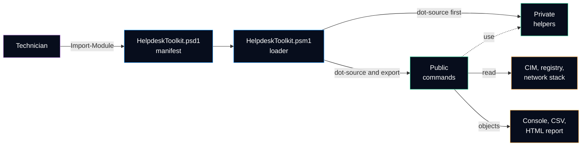

<h1 align="center">Helpdesk Toolkit</h1>

<p align="center">
  <b>A PowerShell module that turns the first minutes of a help desk ticket into repeatable, read-only checks.</b><br>
  System report · Network health · Installed software · Disk health · HTML report for the ticket
</p>

<p align="center">
  
  
  
  
  <br>
  <a href="https://github.com/Bazeeza/helpdesk-toolkit/actions/workflows/ci.yml"></a>
  <a href="https://github.com/Bazeeza/helpdesk-toolkit/actions/workflows/markdown.yml"></a>
  <a href="CHANGELOG.md"></a>
</p>

> **En bref (français) :** module PowerShell de diagnostic pour le soutien technique, compatible avec Windows PowerShell 5.1 (le shell présent sur tous les postes Windows). Chaque commande lit l'état du poste sans le modifier et renvoie des objets réutilisables (CSV, rapport HTML). Le code est vérifié à chaque modification : PSScriptAnalyzer, tests Pester sous PowerShell 5.1 et 7. **Version 0.1.0 :** ossature, tests et CI ; les commandes arrivent une à une (voir la feuille de route).

---

## Why this module

The first questions of almost every ticket are the same: *which Windows build, how much free space, is the network up to the gateway, is the software installed, since when has the computer been running?* Typing them by hand is slow and the answers end up as screenshots in the ticket.

`HelpdeskToolkit` answers them with commands that:

- **only read** the computer (the single command that cleans files will support `-WhatIf` and `-Confirm`);
- return **objects**, so the same data can be filtered, exported to CSV or put in an HTML report;
- run in **Windows PowerShell 5.1**, already installed on every Windows 10 and Windows 11 workstation;
- are **tested** with Pester and mocks, so the tests never depend on the computer they run on.

## Architecture



Details and the reasons behind each choice: [docs/architecture.md](docs/architecture.md).

## Quick start

```powershell
# Get the code
git clone https://github.com/Bazeeza/helpdesk-toolkit.git
cd helpdesk-toolkit

# If the files came from a downloaded ZIP, remove the "downloaded from the Internet" mark
Get-ChildItem -Recurse -File | Unblock-File

# Load the module for the current session and list its commands
Import-Module .\HelpdeskToolkit\HelpdeskToolkit.psd1
Get-Command -Module HelpdeskToolkit
```

> [!NOTE]
> Version 0.1.0 is the skeleton of the module: loader, private helper, tests and CI. It does not export any command yet, so `Get-Command` returns nothing. Commands are added one at a time, each with its tests.

## Roadmap

| Command | What it answers | Status |
|---|---|---|
| `Get-SystemReport` | Which Windows, which hardware, how much memory, since when is it running, what is the serial number? | Planned |
| `Test-NetworkHealth` | Where does the network stop: adapter, IP address or APIPA, gateway, DNS or remote port? | Planned |
| `Get-InstalledSoftware` | Is the application installed, which version, since when? Read from the registry, exported to CSV | Planned |
| `Get-DiskHealth` | How much free space is left, and does the disk report a health problem? | Planned |
| `Clear-TempFiles` | Free space safely, with `-WhatIf` to preview and `-Confirm` to approve | Planned |
| `Export-HelpdeskReport` | One self-contained HTML file to attach to the ticket | Planned |

`Test-NetworkHealth` automates the layer-by-layer method of the [Network Troubleshooting runbook](https://github.com/Bazeeza/Technical-Runbooks/blob/main/04-Network-Troubleshooting/README.md) from [Technical Runbooks](https://github.com/Bazeeza/Technical-Runbooks).

## Quality checks

| Check | Where | What it catches |
|---|---|---|
| PSScriptAnalyzer | Linux runner | Unapproved verbs, unused variables, syntax that Windows PowerShell 5.1 does not understand |
| Pester 5 | Windows PowerShell 5.1 and PowerShell 7 | Wrong results, missing help, exports that do not match the manifest, files that 5.1 would misread |
| markdownlint and lychee | Linux runner | Broken Markdown and broken links between the documents |

The same analysis and tests run on a workstation with one command:

```powershell
.\Invoke-Tests.ps1
```

## Repository layout

```text
helpdesk-toolkit/
├── HelpdeskToolkit/        the module: manifest, loader, Public and Private functions
├── Tests/                  Pester tests and analyzer settings for the tests
├── docs/                   architecture and design decisions
├── Invoke-Tests.ps1        PSScriptAnalyzer and Pester, locally and in the CI
├── CHANGELOG.md            what changed in each version
└── CONTRIBUTING.md         how to add a command and the rules it must follow
```

## Contributing and license

Read [CONTRIBUTING.md](CONTRIBUTING.md) before adding a command. Released under the [MIT License](LICENSE).
