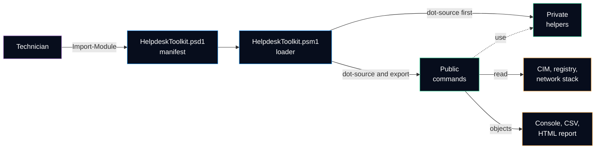

<h1 align="center">Helpdesk Toolkit</h1>

<p align="center">
  <b>A PowerShell module that turns the first minutes of a help desk ticket into repeatable, read-only checks.</b><br>
  System report · Network health · Installed software · Disk health · HTML report for the ticket
</p>

<p align="center">
  
  
  
  
  <br>
  <a href="https://github.com/Bazeeza/helpdesk-toolkit/actions/workflows/ci.yml"></a>
  <a href="https://github.com/Bazeeza/helpdesk-toolkit/actions/workflows/markdown.yml"></a>
  <a href="CHANGELOG.md"></a>
</p>

> **En bref (français) :** module PowerShell de diagnostic pour le soutien technique, compatible avec Windows PowerShell 5.1 (le shell présent sur tous les postes Windows). Chaque commande lit l'état du poste sans le modifier et renvoie des objets réutilisables (CSV, rapport HTML). Le code est vérifié à chaque modification : PSScriptAnalyzer, tests Pester sous PowerShell 5.1 et 7. **Version 0.3.0 :** `Get-SystemReport` (Windows, matériel, numéro de série, mémoire, disques, temps depuis le dernier démarrage) et `Test-NetworkHealth` (diagnostic réseau couche par couche : lien, adresse IP ou APIPA, passerelle, Internet, DNS, port TCP, avec la couche en panne et sa cause probable). **Version 0.4.0 :** `Get-InstalledSoftware` (logiciels installés lus dans le registre, 64 bits, 32 bits et par utilisateur, prêts pour un export CSV, sans jamais interroger `Win32_Product`, qui peut lancer une réparation des paquets MSI). **Version 0.5.0 :** `Get-DiskHealth` (espace libre de chaque volume avec seuils d'alerte, état de santé déclaré par chaque disque physique, un statut global et la liste des problèmes) et `Clear-TempFiles`, la seule commande qui modifie le poste : aperçu avec `-WhatIf`, confirmation demandée par défaut, emplacements fixes seulement, liens jamais suivis. **Version 0.6.0 :** `Export-HelpdeskReport`, un rapport HTML autonome (un seul fichier, style intégré, aucun script) qui combine les quatre diagnostics, avec mode sombre ou clair selon le système, bouton pour changer de thème, impression sur fond blanc, et une section « Not collected » avec la raison quand un diagnostic échoue. Toutes les valeurs venant du poste sont encodées en HTML.

---

## Why this module

The first questions of almost every ticket are the same: *which Windows build, how much free space, is the network up to the gateway, is the software installed, since when has the computer been running?* Typing them by hand is slow and the answers end up as screenshots in the ticket.

`HelpdeskToolkit` answers them with commands that:

- **only read** the computer (the single command that cleans files, `Clear-TempFiles`, previews with `-WhatIf` and asks before acting; `Export-HelpdeskReport` only creates its report file);
- return **objects**, so the same data can be filtered, exported to CSV or put in an HTML report;
- run in **Windows PowerShell 5.1**, already installed on every Windows 10 and Windows 11 workstation;
- are **tested** with Pester and mocks, so the tests never depend on the computer they run on.

## Architecture



Details and the reasons behind each choice: [docs/architecture.md](docs/architecture.md).

## Quick start

```powershell
# Get the code
git clone https://github.com/Bazeeza/helpdesk-toolkit.git
cd helpdesk-toolkit

# If the files came from a downloaded ZIP, remove the "downloaded from the Internet" mark
Get-ChildItem -Recurse -File | Unblock-File

# Load the module for the current session and list its commands
Import-Module .\HelpdeskToolkit\HelpdeskToolkit.psd1
Get-Command -Module HelpdeskToolkit
```

### First ticket check: Get-SystemReport

```powershell
# Windows edition and build, model, serial number, memory, disks and uptime
Get-SystemReport

# Has the computer really restarted this week?
Get-SystemReport | Where-Object { $_.Uptime.TotalDays -gt 7 }

# Free space of each fixed disk, as a table
Get-SystemReport | Select-Object -ExpandProperty Disks
```

The console shows a short view; every property stays on the object (`Select-Object *`). All properties, data sources and remote requirements: [docs/commands/Get-SystemReport.md](docs/commands/Get-SystemReport.md).

### "I have no Internet": Test-NetworkHealth

```powershell
# Link, IPv4 address or APIPA, gateway, public IP, DNS and HTTPS port, in that order
Test-NetworkHealth

# The six steps as a table: Pass, Warning, Fail or Skipped
Test-NetworkHealth | Select-Object -ExpandProperty Checks

# Can this computer reach the network printer on its printing port?
Test-NetworkHealth -TargetHost 'print01.corp.example.com' -Port 9100
```

The result names the first layer that failed (`FailedStep`) and what it means (`Diagnosis`), for example *DHCP problem* for an address in `169.254.x.x`. A gateway that ignores ping is reported as a `Warning` when traffic still goes through. Steps, statuses and design choices: [docs/commands/Test-NetworkHealth.md](docs/commands/Test-NetworkHealth.md).

### "Is it installed, which version?": Get-InstalledSoftware

```powershell
# Is a browser installed, which version and since when?
Get-InstalledSoftware -Name '*Chrome*', '*Firefox*'

# What changed last? The ten most recently installed or updated programs
Get-InstalledSoftware | Sort-Object -Property InstallDate -Descending | Select-Object -First 10

# Software inventory as a CSV file for the ticket
Get-InstalledSoftware | Export-Csv -Path .\software.csv -NoTypeInformation -Encoding UTF8
```

The list is the one of *Programs and Features*: 64-bit, 32-bit (`WOW6432Node`) and per-user programs, read from the registry. The command never queries `Win32_Product`, which makes Windows Installer check and possibly repair every MSI package. Sources, hidden entries and output: [docs/commands/Get-InstalledSoftware.md](docs/commands/Get-InstalledSoftware.md).

### "My disk is full": Get-DiskHealth and Clear-TempFiles

```powershell
# Free space of each volume and health reported by each drive, with one overall status
Get-DiskHealth

# Only the problems, one line each, for the ticket
Get-DiskHealth | Select-Object -ExpandProperty Issues

# Preview: how much would removing temporary files older than 7 days free? Removes nothing
Clear-TempFiles -WhatIf

# Do it, after a confirmation
Clear-TempFiles
```

`Get-DiskHealth` flags a volume under 15 % (`Warning`) or 5 % (`Critical`) of free space and reads the health status that each physical disk reports; temperature, wear and error counters are added in an elevated session. Rules and output: [docs/commands/Get-DiskHealth.md](docs/commands/Get-DiskHealth.md).

`Clear-TempFiles` is the only command that changes the computer. It cleans fixed temporary folders only, keeps recent and busy files, never follows links, and asks before each folder unless `-Confirm:$false` is given. Safety checks and output: [docs/commands/Clear-TempFiles.md](docs/commands/Clear-TempFiles.md).

### Hand over the ticket: Export-HelpdeskReport

```powershell
# System, network, disk health and installed software in one HTML file, in the current folder
Export-HelpdeskReport

# On the desktop with the ticket number, then open it in the browser
Export-HelpdeskReport -Path "$env:USERPROFILE\Desktop" -TicketNumber 'INC-0042' -PassThru | Invoke-Item

# Only the sections that matter for this ticket
Export-HelpdeskReport -Section Network, Disk
```

One self-contained file to attach to the ticket: summary cards coloured by status, then the details of each section. The style sheet is embedded and the page runs no script, so it opens offline and from an e-mail. It follows the dark or light theme of the system, has a theme switch, and prints on white paper. A diagnostic that fails is written as *Not collected* with the reason, and every value read on the computer is HTML-encoded. Layout and design choices: [docs/commands/Export-HelpdeskReport.md](docs/commands/Export-HelpdeskReport.md).

> [!NOTE]
> Version 0.6.0 exports six commands: `Get-SystemReport`, `Test-NetworkHealth`, `Get-InstalledSoftware`, `Get-DiskHealth`, `Clear-TempFiles` and `Export-HelpdeskReport`. The report contains the serial number and network addresses of the computer: share it through the ticket only.

## Roadmap

| Command | What it answers | Status |
|---|---|---|
| [`Get-SystemReport`](docs/commands/Get-SystemReport.md) | Which Windows, which hardware, how much memory, since when is it running, what is the serial number? | Available |
| [`Test-NetworkHealth`](docs/commands/Test-NetworkHealth.md) | Where does the network stop: adapter, IP address or APIPA, gateway, Internet, DNS or remote port? | Available |
| [`Get-InstalledSoftware`](docs/commands/Get-InstalledSoftware.md) | Is the application installed, which version, since when? Read from the registry, never `Win32_Product`, ready for CSV | Available |
| [`Get-DiskHealth`](docs/commands/Get-DiskHealth.md) | How much free space is left, and does the disk report a health problem? | Available |
| [`Clear-TempFiles`](docs/commands/Clear-TempFiles.md) | Free space safely, with `-WhatIf` to preview and `-Confirm` to approve | Available |
| [`Export-HelpdeskReport`](docs/commands/Export-HelpdeskReport.md) | One self-contained HTML file to attach to the ticket, in a dark or light theme | Available |

`Test-NetworkHealth` automates the six steps of the layer-by-layer method of the [Network Troubleshooting runbook](https://github.com/Bazeeza/Technical-Runbooks/blob/main/04-Network-Troubleshooting/README.md) from [Technical Runbooks](https://github.com/Bazeeza/Technical-Runbooks).

## Quality checks

| Check | Where | What it catches |
|---|---|---|
| PSScriptAnalyzer | Linux runner | Unapproved verbs, unused variables, syntax that Windows PowerShell 5.1 does not understand |
| Pester 5 | Windows PowerShell 5.1 and PowerShell 7 | Wrong results, missing help, exports that do not match the manifest, files that 5.1 would misread |
| markdownlint and lychee | Linux runner | Broken Markdown and broken links between the documents |

The same analysis and tests run on a workstation with one command:

```powershell
.\Invoke-Tests.ps1
```

## Repository layout

```text
helpdesk-toolkit/
├── HelpdeskToolkit/        the module: manifest, loader, Public and Private functions
├── Tests/                  Pester tests and analyzer settings for the tests
├── docs/                   architecture, design decisions and one page per command
├── Invoke-Tests.ps1        PSScriptAnalyzer and Pester, locally and in the CI
├── CHANGELOG.md            what changed in each version
└── CONTRIBUTING.md         how to add a command and the rules it must follow
```

## Contributing and license

Read [CONTRIBUTING.md](CONTRIBUTING.md) before adding a command. Released under the [MIT License](LICENSE).
