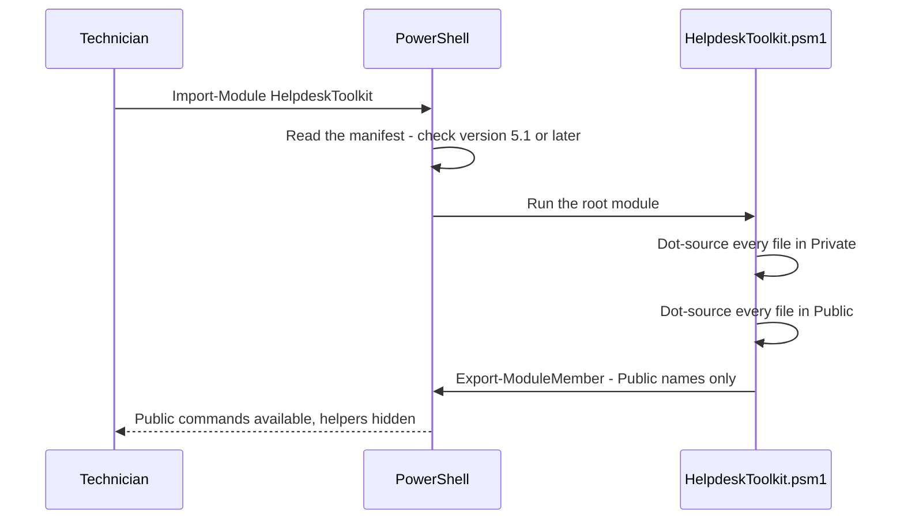

# Module architecture

This page explains how `HelpdeskToolkit` is organized, how PowerShell loads it, and why each design choice was made.

## Folder layout

```text
helpdesk-toolkit/
├── HelpdeskToolkit/              The module itself (the folder you copy to a workstation)
│   ├── HelpdeskToolkit.psd1      Manifest: version, minimum PowerShell version, exported commands
│   ├── HelpdeskToolkit.psm1      Root module: loads Private, then Public, exports Public
│   ├── HelpdeskToolkit.Types.ps1xml  Default console view of the report objects
│   ├── Public/                   One exported command per file, file name = command name
│   └── Private/                  Internal helpers, never exported (Format-ByteSize, Format-Uptime,
│                                 Test-IcmpEcho, Test-TcpPort)
├── Tests/
│   ├── Module.Tests.ps1          Rules every command must follow (help, verb, encoding...)
│   ├── Private/                  One test file per private helper
│   ├── Public/                   One test file per public command
│   └── PSScriptAnalyzerSettings.psd1
├── docs/                         This documentation
│   └── commands/                 One reference page per public command
├── Invoke-Tests.ps1              Same checks on a workstation and in GitHub Actions
└── PSScriptAnalyzerSettings.psd1 Analyzer rules for the module
```

## How the module loads



A file that fails to load stops the import with its name in the error message, instead of leaving a half-loaded module.

## Design decisions

| Decision | Why |
|---|---|
| **One function per file** | A change to one command touches one file, so a pull request is easy to review and the history of each command stays readable. |
| **Public and Private folders** | Helpers such as `Format-ByteSize` can change freely without breaking scripts that use the module, because nobody outside the module can call them. |
| **Explicit `FunctionsToExport` list** | PowerShell finds the commands without loading the module (command discovery), and a wildcard cannot export a helper by mistake. A test fails if the list and the `Public` folder disagree. |
| **Windows PowerShell 5.1 as the minimum** | It is installed on every Windows 10 and Windows 11 workstation. A help desk tool cannot require installing PowerShell 7 first. The CI runs the tests in both 5.1 and 7. |
| **ASCII source files** | Windows PowerShell 5.1 reads a file without a byte order mark with the ANSI code page, so an accented letter or a dash copied from a web page becomes garbage or a syntax error. A test checks every file. |
| **Read-only by default** | Diagnostic commands only read. The only command planned to change something (`Clear-TempFiles`) must support `-WhatIf` and `-Confirm`. |
| **Objects, not text** | Commands return objects. The technician can sort, filter, export to CSV or build the HTML report from the same data, without parsing text. |
| **Invariant formatting in reports** | Sizes and numbers use a dot as decimal separator on every workstation, so two reports from a French and an English computer can be compared. |
| **Raw value and readable text side by side** | `MemoryBytes` and `Memory`, `Uptime` and `UptimeText`: the number is for sorting and filtering, the text is for the ticket. |
| **CIM, not WMI cmdlets** | `Get-CimInstance` works in Windows PowerShell 5.1 and PowerShell 7; `Get-WmiObject` does not exist in PowerShell 7. Remote queries use WinRM instead of DCOM. |
| **Short default view, full object** | A types file chooses the properties shown in the console. Every property stays on the object for `Select-Object *`, CSV and the HTML report. |
| **One unreachable computer does not stop the others** | Remote failures are non-terminating errors that name the computer. `-ErrorAction Stop` restores the stop-at-first-error behaviour. |
| **Network tests through small .NET helpers** | `Test-IcmpEcho` (class `Ping`) and `Test-TcpPort` (class `TcpClient`) behave the same in 5.1 and 7 and stop after a short timeout. `Test-Connection` changed in PowerShell 7, and `Test-NetConnection` can wait about 20 seconds on a filtered port. Being private functions, they are also easy to mock in the tests. |
| **A diagnosis, not only a status** | `Test-NetworkHealth` returns the first layer that failed and what it means (`DHCP problem`, `DNS problem`...), the sentence a technician writes in the ticket. |
| **Tests and examples use documentation values** | Fictitious computers (`PC-EXAMPLE01`), the address range `192.0.2.0/24` (RFC 5737) and the MAC block `00-00-5E-00-53-xx` (RFC 7042): no real serial number, address or host name ends up in the repository. |

## Commands

The module is built one command at a time, each with its tests and documentation. The [CHANGELOG](../CHANGELOG.md) records each release.

| Command | Purpose | Status |
|---|---|---|
| [`Get-SystemReport`](commands/Get-SystemReport.md) | Operating system, CPU, memory, disks, uptime and serial number in one object | Available (0.2.0) |
| [`Test-NetworkHealth`](commands/Test-NetworkHealth.md) | The steps of the network troubleshooting runbook, automated: adapter, IP address or APIPA, gateway, public IP, DNS, TCP port | Available (0.3.0) |
| `Get-InstalledSoftware` | Installed programs read from the registry, with CSV export | Planned |
| `Get-DiskHealth` | Free space and physical disk health status | Planned |
| `Clear-TempFiles` | Remove temporary files, with mandatory `-WhatIf` and `-Confirm` support | Planned |
| `Export-HelpdeskReport` | A self-contained HTML report that combines the commands above | Planned |

`Test-NetworkHealth` follows the layer-by-layer method of the [Network Troubleshooting runbook](https://github.com/Bazeeza/Technical-Runbooks/blob/main/04-Network-Troubleshooting/README.md) of the Technical Runbooks repository.

### Why the registry and not `Win32_Product`

`Get-InstalledSoftware` will read the uninstall keys of the registry. Querying the WMI class `Win32_Product` looks simpler but makes Windows Installer enumerate every MSI package and start a consistency check that can **reconfigure installed applications** (event 1035 in the Application log) and slow the computer down. A diagnostic tool must never change the computer it diagnoses.

---

**Reference:** [Windows Installer reconfigured all applications (Microsoft Learn)](https://learn.microsoft.com/en-us/troubleshoot/windows-server/admin-development/windows-installer-reconfigured-all-applications) · [about_Modules (Microsoft Learn)](https://learn.microsoft.com/en-us/powershell/module/microsoft.powershell.core/about/about_modules) · [How to write a PowerShell module manifest (Microsoft Learn)](https://learn.microsoft.com/en-us/powershell/scripting/developer/module/how-to-write-a-powershell-module-manifest)
