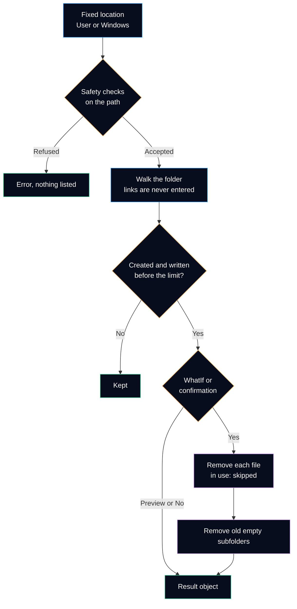

# Clear-TempFiles

Removes old files from the temporary folders to free disk space. It is the **only command of the module that changes the computer**, so it previews with `-WhatIf`, asks before each folder, and refuses any folder that is not a temporary folder.

It answers the follow-up question of a full disk: *how much space can be freed safely, right now?*

## Syntax

```powershell
Clear-TempFiles [-Location <String[]>] [-OlderThanDays <Int32>] [-WhatIf] [-Confirm] [<CommonParameters>]
```

| Parameter | Type | Default | Description |
|---|---|---|---|
| `-Location` | `String[]` | `User` | `User` (temporary folder of the current user), `Windows` (`C:\Windows\Temp`, needs administrator rights), or both. No free path is accepted. |
| `-OlderThanDays` | `Int32` | `7` | Only files created **and** written more than this number of days ago are removed. 0 to 3650. |
| `-WhatIf` | `Switch` | off | Shows what would be removed and how much space it would free. Removes nothing. |
| `-Confirm` | `Switch` | on (impact `High`) | Asks before each location. `-Confirm:$false` removes without asking, for a script. |

The complete help is also available in PowerShell: `Get-Help Clear-TempFiles -Full`.

## How it decides



### Safety checks

Before anything is listed, the path of each location must pass every rule. A refused location is reported as an error and the next location is still processed.

| Rule | Refused example |
|---|---|
| Absolute path | `Temp` |
| Not the root of a drive | `C:\` |
| Not a system or profile folder (`%windir%`, `%USERPROFILE%`, `%ProgramFiles%`, `%ProgramData%`, `%LOCALAPPDATA%`, `%APPDATA%`) | `C:\Windows` |
| Inside a folder named `Temp` or `Tmp` | `C:\Windows\System32` |
| The folder exists | `C:\Missing-Example\Temp` |

### What is kept

| Item | Why |
|---|---|
| Files created or written in the last `-OlderThanDays` days | A running installer or an open application may still need them. A file copied today keeps its old write time but has a new creation time, so both dates are checked. |
| Files in use, read-only or denied | Removing them fails; they are counted in `FilesSkipped` and the cleanup goes on. |
| Junctions and symbolic links | Never entered: a link inside a temporary folder could point to documents. |
| Subfolders created recently or not empty | `Delete()` is called without recursion, so a folder with content is never removed. |
| The temporary folder itself | Windows and applications expect it to exist. |

## Output

Type name: `HelpdeskToolkit.TempCleanup`. One object per location that passed the safety checks.

| Property | Type | Meaning |
|---|---|---|
| `ComputerName` | String | Local computer name |
| `Location`, `Path` | String | `User` or `Windows`, and the folder cleaned |
| `OlderThanDays` | Int32 | Age limit used |
| `FilesFound`, `SizeFound`, `BytesFound` | Int32, String, Int64 | Files old enough to be removed, and their total size |
| `Cleaned` | Boolean | `False` with `-WhatIf`, when the confirmation was refused, or when nothing was old enough |
| `FilesRemoved`, `FilesSkipped`, `FoldersRemoved` | Int32 | What was actually done |
| `Freed`, `BytesFreed` | String, Int64 | Space freed |
| `UnreadableFolders` | Int32 | Folders that could not be listed (access denied) |

### Default view

Example with **fictitious** values, first as a preview, then for real:

```text
PS> Clear-TempFiles -WhatIf
What if: Performing the operation "Remove 1250 files (812.4 MB) older than 7 days" on target "C:\Users\example\AppData\Local\Temp".

Location     : User
FilesFound   : 1250
SizeFound    : 812.4 MB
Cleaned      : False
FilesRemoved : 0
FilesSkipped : 0
Freed        : 0 B

PS> Clear-TempFiles -Confirm:$false

Location     : User
FilesFound   : 1250
SizeFound    : 812.4 MB
Cleaned      : True
FilesRemoved : 1243
FilesSkipped : 7
Freed        : 806.1 MB
```

## Examples

```powershell
# Preview: what would be removed, and how much space it would free
Clear-TempFiles -WhatIf

# Remove the old files of the current user, after a confirmation
Clear-TempFiles

# Elevated PowerShell: both folders, files older than 30 days, no question (maintenance script)
Clear-TempFiles -Location User, Windows -OlderThanDays 30 -Confirm:$false

# Before and after: free space of C: around the cleanup
(Get-DiskHealth).Volumes | Where-Object Drive -eq 'C:'
Clear-TempFiles -Confirm:$false | Select-Object Location, Freed, FilesSkipped
(Get-DiskHealth).Volumes | Where-Object Drive -eq 'C:'
```

## Design choices

| Choice | Why |
|---|---|
| `SupportsShouldProcess` with `ConfirmImpact = 'High'` | The PowerShell convention for a command that changes the system: `-WhatIf` and `-Confirm` work as in every built-in cmdlet. `High` is at the default `$ConfirmPreference`, so the command asks unless told not to. |
| One confirmation per location, not per file | A temporary folder can hold thousands of files; one question per file would push the technician to answer *Yes to All* without reading. The question states the number of files, their size and the folder. |
| Fixed locations, no `-Path` parameter | A typing mistake in a path cannot point the command at a folder of documents. The locations come from a private helper, `Get-TempLocation`, which the tests replace with a folder of Pester's `TestDrive`. |
| Own folder walk instead of `Get-ChildItem -Recurse` | The private helper `Get-TempFileCandidate` checks the `ReparsePoint` attribute of every item and never enters a link, in Windows PowerShell 5.1 and PowerShell 7 alike. A folder that cannot be listed is counted instead of stopping the walk. |
| Plural name | `PSUseSingularNouns` is suppressed for this function only, with the reason in the code: the command empties temporary folders as a whole, and the name was published in the roadmap. |
| No Disk Cleanup or Storage Sense | Those tools clean more (Windows Update cache, Recycle Bin) but run as a whole, without a preview object. This command does one thing and reports it. |

## Tests

[`Tests/Public/Clear-TempFiles.Tests.ps1`](../../Tests/Public/Clear-TempFiles.Tests.ps1) creates real files and folders with chosen ages in a `Temp` folder of Pester's `TestDrive`: the `-WhatIf` preview removes nothing, old files and empty old folders are removed, recent ones are kept, `-OlderThanDays` is respected, a locked file is skipped, a junction to another folder is not followed, and each safety rule refuses its example path (with `-WhatIf` as a second safeguard). [`Get-TempFileCandidate`](../../Tests/Private/Get-TempFileCandidate.Tests.ps1) and [`Get-TempLocation`](../../Tests/Private/Get-TempLocation.Tests.ps1) have their own tests.

---

**Reference:** [Everything you wanted to know about ShouldProcess (Microsoft Learn)](https://learn.microsoft.com/en-us/powershell/scripting/learn/deep-dives/everything-about-shouldprocess) · [about_Preference_Variables: ConfirmPreference](https://learn.microsoft.com/en-us/powershell/module/microsoft.powershell.core/about/about_preference_variables) · [FileSystemInfo.Attributes and ReparsePoint (.NET)](https://learn.microsoft.com/en-us/dotnet/api/system.io.fileattributes) · [DirectoryInfo.Delete (.NET)](https://learn.microsoft.com/en-us/dotnet/api/system.io.directoryinfo.delete) · [Free up drive space in Windows](https://support.microsoft.com/en-us/windows/free-up-drive-space-in-windows-85529ccb-c365-490d-b548-831022bc9b32)
