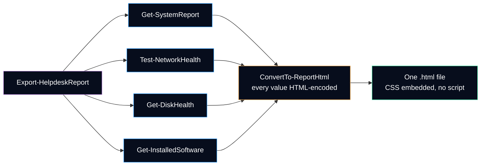

# Export-HelpdeskReport

Runs the read-only diagnostics of the module on the local computer and saves them as **one self-contained HTML file** to attach to the ticket: summary cards coloured by status, then the details of each section.

It answers the last question of a first-level ticket: *how do I hand over what I checked, without ten screenshots?*

## Syntax

```powershell
Export-HelpdeskReport [[-Path] <String>] [-Section <String[]>] [-TicketNumber <String>] [-Force] [-PassThru] [-WhatIf] [-Confirm] [<CommonParameters>]
```

| Parameter | Type | Default | Description |
|---|---|---|---|
| `-Path` | `String` | `HelpdeskReport-<computer>-<yyyyMMdd-HHmmss>.html` in the current folder | File to create, or an existing folder to create the default file name in. A relative path starts at the current PowerShell location. |
| `-Section` | `String[]` | `System`, `Network`, `Disk`, `Software` | Sections to include. They always appear in that order. |
| `-TicketNumber` | `String` | none | Shown in the header and the page title, for example `INC-0042`. Letters, digits and `. _ # -`, up to 40 characters. |
| `-Force` | `Switch` | off | Replaces the file if it already exists. |
| `-PassThru` | `Switch` | off | Returns the file written (`System.IO.FileInfo`). |
| `-WhatIf` | `Switch` | off | Shows the file that would be written. Collects nothing, writes nothing. |

The complete help is also available in PowerShell: `Get-Help Export-HelpdeskReport -Full`.

## What the report contains



| Section | Command | Card | Details |
|---|---|---|---|
| System | [`Get-SystemReport`](Get-SystemReport.md) | Windows edition, uptime and build | Manufacturer, model, serial number, firmware, Windows version, processor, memory in use, last boot; local disks with a free space bar |
| Network | [`Test-NetworkHealth`](Test-NetworkHealth.md) | `Pass`, `Warning` or `Fail`, and the step where it stops | Diagnosis, the six steps with their status, adapter, IPv4 address, gateway and DNS servers |
| Disk health | [`Get-DiskHealth`](Get-DiskHealth.md) | Overall status and number of issues | Issues, volumes with free space bar and status, thresholds used, physical disks with health, temperature and wear when available |
| Installed software | [`Get-InstalledSoftware`](Get-InstalledSoftware.md) | Number of programs | Name, version, publisher, install date, scope and architecture |

The network card is `Fail` when a step failed, `Warning` when every step answered but one of them is a `Warning` (a gateway that ignores ping, for example), and `Pass` otherwise.

### Page layout

| Part | What it shows |
|---|---|
| Header | Computer name, ticket number, date and time with the UTC offset |
| Contents | Links to the sections, when there are two or more |
| Cards | One per section, with a coloured left border: green, orange, red, grey for missing data |
| Sections | The details above; each status is a coloured badge **and** a word, so it reads in black and white too |
| Footer | Module version and a reminder that the file contains computer identifiers |

### Themes and printing

The page follows the theme of Windows or of the browser (`prefers-color-scheme`): dark by default with the colours of this project, light when the system is light. The **Switch theme** button swaps them; it is a CSS-only switch (`:has()`), so it works without JavaScript, and browsers without `:has()` keep the system theme. Printing always uses the light theme and hides the switch and the contents. Every status colour has a contrast ratio of at least 4.5:1 on its background (WCAG AA), checked by a test.

## When a section fails

A section that cannot be collected does not stop the report. The command:

1. writes a warning that names the section and the reason;
2. still writes the section, with a grey **Not collected** badge and the error message;
3. writes the other sections normally.

A non-terminating error of a command (for example `Get-SystemReport` that cannot read a CIM class) counts as a failure too, because each command is called with `-ErrorAction Stop`. An empty program list is not a failure: it reads *No program found*.

> [!NOTE]
> Missing data is shown as missing, never as healthy: a report without its disk section says *Not collected*, not *OK*.

## Output

None by default, like `Export-Csv`. With `-PassThru`, the `System.IO.FileInfo` of the report, which can be piped to `Invoke-Item` to open it.

The file is UTF-8 without byte order mark, as declared in the page (`<meta charset="utf-8">`), and weighs about 24 KB on a workstation with about 80 programs.

## Examples

```powershell
# Report with the four sections in the current folder
Export-HelpdeskReport

# On the desktop, with the ticket number, then open it in the default browser
Export-HelpdeskReport -Path "$env:USERPROFILE\Desktop" -TicketNumber 'INC-0042' -PassThru | Invoke-Item

# Only network and disk, for a "slow and disconnected" ticket
Export-HelpdeskReport -Section Network, Disk -Path .\network-and-disk.html

# Which file would be written? Collects and writes nothing
Export-HelpdeskReport -WhatIf

# Run it on a remote computer, then copy the report back (module copied in C:\Tools)
$session = New-PSSession -ComputerName 'PC-EXAMPLE01'
$report = Invoke-Command -Session $session -ScriptBlock {
    Import-Module -Name 'C:\Tools\HelpdeskToolkit\HelpdeskToolkit.psd1'
    Export-HelpdeskReport -Path $env:TEMP -PassThru
}
Copy-Item -FromSession $session -Path $report.FullName -Destination .\
Remove-PSSession -Session $session
```

## Design choices

| Choice | Why |
|---|---|
| One file, CSS embedded, no script | The report is opened from a ticket attachment, an e-mail or a USB key, often offline. Nothing to install, nothing loaded from the Internet, and nothing a mail filter would block. |
| Every value HTML-encoded | Program names, publishers and error messages come from the computer: any installer can write `<script>` in its display name. `ConvertTo-HtmlText` encodes every value with `System.Net.WebUtility.HtmlEncode`, and removes control characters such as the NUL found in a real registry value. |
| Content-Security-Policy in the page | `default-src 'none'; style-src 'unsafe-inline'`: the browser allows the embedded style and refuses every script, image, font or frame. A second barrier if a value ever escaped encoding. |
| Own HTML builder instead of `ConvertTo-Html` | `ConvertTo-Html` writes a whole page per call, cannot colour one status cell and differs between Windows PowerShell 5.1 and PowerShell 7. Four small private helpers do the job and are each tested. |
| `SupportsShouldProcess` | The command creates a file, so it supports `-WhatIf` and `-Confirm` like `Out-File`. Its impact is `Medium`: it does not ask by default, because creating a new report is not destructive. |
| No overwrite without `-Force` | A second run must not silently replace the report already attached to a ticket. The default file name contains the date and time, so two runs do not collide. |
| `-WhatIf` collects nothing | The preview answers *where would the file go?* in a fraction of a second, without the few seconds of network tests. |
| One failed section does not stop the report | A technician still gets the three other sections, and the missing one says why. |
| Fixed section order | The same report always reads the same way, whatever order `-Section` was typed in. |
| Local computer only | Like the other commands that read local classes, it runs on another computer through PowerShell remoting (see the last example). |

## Privacy

The report contains the **computer name, serial number, MAC and IP addresses and the list of installed programs**. Attach it to the ticket; do not post it in a public channel. The examples, tests and documentation of this repository use fictitious values only (`PC-EXAMPLE01`, `192.0.2.0/24`).

## Tests

[`Tests/Public/Export-HelpdeskReport.Tests.ps1`](../../Tests/Public/Export-HelpdeskReport.Tests.ps1) mocks the four commands and writes in Pester's `TestDrive` only: the four sections, only the sections asked for, fixed order, a section that throws and one that writes a non-terminating error, encoding of values, the ticket number check, a folder as `-Path`, a relative path, an existing file kept without `-Force` and replaced with it, a missing folder, and `-WhatIf` that collects nothing.

The page builder has its own tests with fictitious results: [`ConvertTo-ReportHtml`](../../Tests/Private/ConvertTo-ReportHtml.Tests.ps1), [`ConvertTo-ReportTable`](../../Tests/Private/ConvertTo-ReportTable.Tests.ps1), [`ConvertTo-HtmlText`](../../Tests/Private/ConvertTo-HtmlText.Tests.ps1), [`ConvertTo-StatusBadge`](../../Tests/Private/ConvertTo-StatusBadge.Tests.ps1) and [`Get-ReportStyleSheet`](../../Tests/Private/Get-ReportStyleSheet.Tests.ps1), which computes the WCAG contrast ratio of every status colour.

---

**Reference:** [WebUtility.HtmlEncode (Microsoft Learn)](https://learn.microsoft.com/en-us/dotnet/api/system.net.webutility.htmlencode) · [Everything you wanted to know about ShouldProcess (Microsoft Learn)](https://learn.microsoft.com/en-us/powershell/scripting/learn/deep-dives/everything-about-shouldprocess) · [Content-Security-Policy (MDN)](https://developer.mozilla.org/en-US/docs/Web/HTTP/Headers/Content-Security-Policy) · [prefers-color-scheme (MDN)](https://developer.mozilla.org/en-US/docs/Web/CSS/@media/prefers-color-scheme) · [Contrast minimum, WCAG 2.2 (W3C)](https://www.w3.org/WAI/WCAG22/Understanding/contrast-minimum.html)
