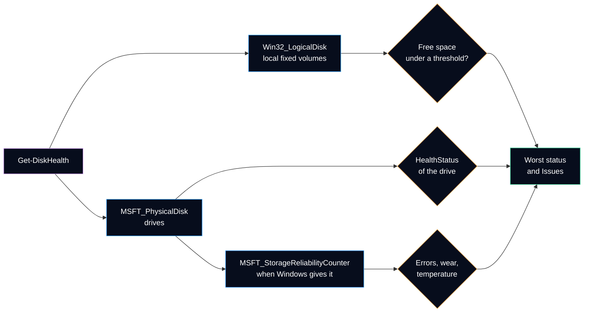

# Get-DiskHealth

Checks the free space of every local fixed volume and the health reported by every physical disk, then gives **one overall status** and **one line per problem**. Read-only.

It answers the two disk questions of a ticket: *is the computer running out of space?* and *is the drive itself failing?*

## Syntax

```powershell
Get-DiskHealth [-WarningPercent <Int32>] [-CriticalPercent <Int32>] [<CommonParameters>]
```

| Parameter | Type | Default | Description |
|---|---|---|---|
| `-WarningPercent` | `Int32` | `15` | A volume with less free space than this percentage of its size is `Warning`. 1 to 99. |
| `-CriticalPercent` | `Int32` | `5` | A volume with less free space than this percentage is `Critical`. 1 to 99, lower than `-WarningPercent`. |

The complete help is also available in PowerShell: `Get-Help Get-DiskHealth -Full`.

## What is checked



| Source | What it gives | Status rule |
|---|---|---|
| `Win32_LogicalDisk` (`DriveType = 3`) | Size and free space of each local fixed volume | `Critical` under `-CriticalPercent`, `Warning` under `-WarningPercent`, otherwise `OK`; `Unknown` when the size is not reported |
| `MSFT_PhysicalDisk` (namespace `root/Microsoft/Windows/Storage`, the class behind `Get-PhysicalDisk`) | Media type (HDD, SSD), bus type (SATA, NVMe, USB), size, `HealthStatus`, `OperationalStatus` | `Healthy` gives `OK`, `Warning` gives `Warning`, `Unhealthy` gives `Critical`, anything else `Unknown` |
| `MSFT_StorageReliabilityCounter` (the data of `Get-StorageReliabilityCounter`) | Temperature, maximum temperature, wear, power-on hours, uncorrected read and write errors | Raises a disk to `Warning` for uncorrected errors, a wear of 100 % or more, or a temperature at or above its maximum |

The overall `Status` is the worst one found, in the order `OK`, `Unknown`, `Warning`, `Critical`. When no physical disk can be read, the result is at least `Unknown`: free space alone does not prove that the drives are healthy.

> [!NOTE]
> Windows usually gives the reliability counters **only to an elevated session**. Without administrator rights, the query returns nothing and no error: the command then sets `ReliabilityAvailable = False` and leaves the counters empty. Run PowerShell as administrator to get them.

## Output

Type name: `HelpdeskToolkit.DiskHealth`. One object for the computer.

| Property | Type | Meaning |
|---|---|---|
| `ComputerName` | String | Local computer name |
| `Status` | String | `OK`, `Unknown`, `Warning` or `Critical` |
| `Healthy` | Boolean | `True` only when `Status` is `OK` |
| `Issues` | String[] | One line per problem, ready to paste in the ticket; empty when healthy |
| `Volumes` | Object[] | One `HelpdeskToolkit.DiskHealth.Volume` per local fixed volume, sorted by letter |
| `PhysicalDisks` | Object[] | One `HelpdeskToolkit.DiskHealth.PhysicalDisk` per drive, sorted by disk number |
| `WarningPercent`, `CriticalPercent` | Int32 | Thresholds used |
| `CollectedAt` | DateTime | When the values were read |

**Volume:** `Drive`, `Label`, `FileSystem`, `Size`, `Free`, `FreePercent`, `SizeBytes`, `FreeBytes`, `Status`.

**Physical disk:** `DeviceId` (disk number), `Name`, `MediaType`, `BusType`, `Size`, `SizeBytes`, `HealthStatus`, `OperationalStatus`, `ReliabilityAvailable`, `Temperature`, `TemperatureMax` (degrees Celsius), `Wear` (percent, 100 = estimated wear limit), `PowerOnHours`, `ReadErrorsUncorrected`, `WriteErrorsUncorrected`, `Status`.

Codes are translated with the values documented for `MSFT_PhysicalDisk`; a code that is not documented is shown as `Unknown (<code>)` rather than guessed.

### Default view

Example with **fictitious** values (a volume under the warning threshold):

```text
PS> Get-DiskHealth

ComputerName  : PC-EXAMPLE01
Status        : Warning
Issues        : {C: 41.2 GB free (8.6 %), warning below 15 %}
Volumes       : {C: 41.2 GB free (8.6 %) Warning}
PhysicalDisks : {Disk 0 SSD 476.94 GB Healthy}
```

## Examples

```powershell
# Overall status and the problems found
Get-DiskHealth

# Only the problems, to copy into the ticket
Get-DiskHealth | Select-Object -ExpandProperty Issues

# Free space of each volume, as a table
Get-DiskHealth | Select-Object -ExpandProperty Volumes

# Every value of every drive (run as administrator for temperature, wear and errors)
Get-DiskHealth | Select-Object -ExpandProperty PhysicalDisks | Format-List *

# Stricter thresholds for a small SSD
Get-DiskHealth -WarningPercent 20 -CriticalPercent 10

# Low on space? Preview what Clear-TempFiles would free, without deleting anything
if (-not (Get-DiskHealth).Healthy) { Clear-TempFiles -WhatIf }
```

## Design choices

| Choice | Why |
|---|---|
| `Get-CimInstance` on `MSFT_PhysicalDisk` instead of `Get-PhysicalDisk` | Same data, one mocking boundary for every command of the module (`Get-CimInstance`), so the tests never read the real disks. The numeric codes are translated in a private helper, `ConvertFrom-StorageCode`. |
| The drive decides its health | `HealthStatus` is computed by Windows and the drive firmware. The command does not invent its own thresholds on raw SMART attributes, which differ between manufacturers. |
| Only documented counters raise a warning | Uncorrected errors, wear at its documented limit of 100 %, and temperature at the maximum the drive reports for itself. Other values are shown, not judged. |
| Missing counters are not an error | Without elevation, Windows returns no counter at all. The command says so (`ReliabilityAvailable = False`) instead of failing or reporting zero errors that were never read. |
| Percentage thresholds | They work for any volume size and match what a technician reads in File Explorer. The defaults (15 % and 5 %) are a common starting point and can be changed per call. |
| Local computer only | The storage classes are queried locally; PowerShell remoting (`Invoke-Command`) runs the command on another computer. |

## Tests

[`Tests/Public/Get-DiskHealth.Tests.ps1`](../../Tests/Public/Get-DiskHealth.Tests.ps1) mocks `Get-CimInstance` and the reliability helper with fictitious volumes, drives and counters: thresholds at their limits, each `HealthStatus` code, sorting of disks 2 and 10, the worst status kept, each counter rule, missing storage classes, an empty disk list, and a volume query that fails. [`ConvertFrom-StorageCode`](../../Tests/Private/ConvertFrom-StorageCode.Tests.ps1) and [`Get-StorageReliability`](../../Tests/Private/Get-StorageReliability.Tests.ps1) have their own tests.

---

**Reference:** [MSFT_PhysicalDisk class (Microsoft Learn)](https://learn.microsoft.com/en-us/windows-hardware/drivers/storage/msft-physicaldisk) · [MSFT_StorageReliabilityCounter class](https://learn.microsoft.com/en-us/windows-hardware/drivers/storage/msft-storagereliabilitycounter) · [Win32_LogicalDisk class](https://learn.microsoft.com/en-us/windows/win32/cimwin32prov/win32-logicaldisk) · [Get-PhysicalDisk](https://learn.microsoft.com/en-us/powershell/module/storage/get-physicaldisk)
