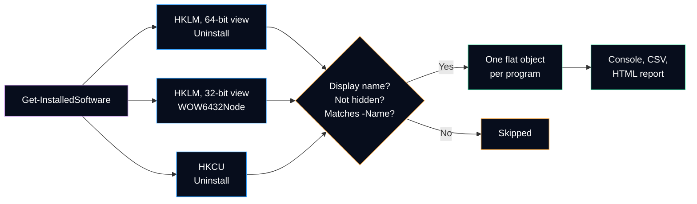

# Get-InstalledSoftware

Lists the programs installed on the local computer: name, version, publisher, install date, scope and architecture. The list is the one shown by *Installed apps* in Settings and *Programs and Features* in the Control Panel, read from the uninstall keys of the registry. Read-only, no administrator rights needed, and **never** through the `Win32_Product` class.

It answers the software questions of a ticket: *is the application installed? which version? since when? what was installed just before the problem started?*

## Syntax

```powershell
Get-InstalledSoftware [[-Name] <String[]>] [-Scope <String>] [-IncludeHidden] [<CommonParameters>]
```

| Parameter | Type | Default | Description |
|---|---|---|---|
| `-Name` | `String[]` | every program | Display names to look for, wildcards accepted (`'*Chrome*'`). A name that matches nothing returns nothing, without error. First positional parameter. |
| `-Scope` | `String` | `All` | `Machine` (installed for every user), `User` (current user only) or `All`. |
| `-IncludeHidden` | `Switch` | off | Also returns system components and updates, which *Programs and Features* hides. |

The complete help is also available in PowerShell: `Get-Help Get-InstalledSoftware -Full`.

## Where the list comes from

Every installer that registers an uninstaller writes one subkey under an `Uninstall` key. The command reads three of them:

| Registry key | Contains | `Scope` | `Architecture` |
|---|---|---|---|
| `HKLM:\SOFTWARE\Microsoft\Windows\CurrentVersion\Uninstall` | 64-bit programs installed for every user | `Machine` | `64-bit` |
| `HKLM:\SOFTWARE\WOW6432Node\Microsoft\Windows\CurrentVersion\Uninstall` | 32-bit programs installed for every user | `Machine` | `32-bit` |
| `HKCU:\Software\Microsoft\Windows\CurrentVersion\Uninstall` | Programs installed for the current user only (often in `%LOCALAPPDATA%`) | `User` | empty |



On 32-bit Windows there is no `WOW6432Node` key: the single `HKLM` list is reported as `32-bit`.

### What is hidden by default

Like *Programs and Features*, the command skips:

| Entry | How it is recognized | Shown with `-IncludeHidden` |
|---|---|---|
| Leftover key without a name | No `DisplayName` value | Never: Windows does not show it either |
| System component | `SystemComponent = 1` (set by the MSI property `ARPSYSTEMCOMPONENT`) | Yes, with `SystemComponent = True` |
| Update of another program | A `ParentKeyName` value, or a `ReleaseType` such as `Hotfix`, `Security Update` or `Update Rollup` | Yes, with `IsUpdate = True` |

## Output

Type name: `HelpdeskToolkit.InstalledSoftware`. One object per program, sorted by name then version. Every property holds a single value, so `Export-Csv` keeps all of them.

| Property | Type | Meaning |
|---|---|---|
| `ComputerName` | String | Local computer name |
| `Name` | String | `DisplayName`, the name shown in *Installed apps* |
| `Version` | String | `DisplayVersion`, as written by the installer (not always a valid version number) |
| `Publisher` | String | `Publisher` |
| `InstallDate` | DateTime | `InstallDate` converted from `yyyyMMdd` (or another common format); empty when missing or unreadable |
| `Scope` | String | `Machine` or `User` |
| `Architecture` | String | `64-bit`, `32-bit`, or empty for a per-user program |
| `EstimatedSize`, `EstimatedSizeBytes` | String, Int64 | `EstimatedSize` (kilobytes in the registry) as readable text and in bytes; empty when the installer wrote none |
| `InstallLocation` | String | Install folder, when the installer wrote it |
| `WindowsInstaller` | Boolean | `True` for an MSI package |
| `ProductCode` | String | Product code GUID of an MSI package (the name of its key) |
| `SystemComponent`, `IsUpdate` | Boolean | Why an entry is hidden by default |
| `UninstallString`, `QuietUninstallString` | String | Commands that uninstall the program, as registered |
| `RegistryPath` | String | Key of the program, usable with `Get-ItemProperty` |

> [!NOTE]
> For an MSI package, `InstallDate` is the **last time the product was installed, patched or repaired**, not always its first installation (Windows Installer documentation). Read it as "last changed on".

### Default view

The console shows `Name`, `Version`, `Publisher`, `InstallDate`, `Scope` and `Architecture`. Example with **fictitious** programs:

```text
PS> Get-InstalledSoftware -Name 'Example*'

Name              Version Publisher InstallDate           Scope   Architecture
----              ------- --------- -----------           -----   ------------
Example Browser   130.0   Fabrikam                        Machine 64-bit
Example Chat      1.2     Fabrikam                        User
Example Editor    2.4.1   Contoso   1/15/2026 12:00:00 AM Machine 64-bit
Example VPN Agent 5.0     Contoso   3/1/2025 12:00:00 AM  Machine 32-bit
```

## Examples

```powershell
# Is a browser installed, which version, since when?
Get-InstalledSoftware -Name '*Chrome*', '*Firefox*', '*Edge*'

# What was installed or updated last? A lead when "it worked yesterday"
Get-InstalledSoftware | Sort-Object -Property InstallDate -Descending | Select-Object -First 10

# Inventory of the computer as a CSV file for the ticket or for Excel
Get-InstalledSoftware |
    Select-Object ComputerName, Name, Version, Publisher, InstallDate, Scope, Architecture |
    Export-Csv -Path .\software.csv -NoTypeInformation -Encoding UTF8

# Same program in two versions? A common cause of conflicts
Get-InstalledSoftware | Group-Object -Property Name | Where-Object { $_.Count -gt 1 }

# Silent uninstall command of a program, before running it by hand
Get-InstalledSoftware -Name 'Example Browser' | Select-Object -ExpandProperty QuietUninstallString

# On a remote computer, after copying the module on it
Invoke-Command -ComputerName 'PC-EXAMPLE01' -ScriptBlock {
    Import-Module -Name 'C:\Tools\HelpdeskToolkit\HelpdeskToolkit.psd1'
    Get-InstalledSoftware -Name '*VPN*'
}
```

## Design choices

| Choice | Why |
|---|---|
| Registry instead of `Win32_Product` | Microsoft warns that `Win32_Product` is not query optimized and that a query starts a consistency check of every installed MSI package, "verifying and repairing the install", which is slow and can write errors in the event logs. A diagnostic command must not change the computer. |
| Explicit 64-bit and 32-bit registry views | The registry redirector shows 32-bit processes the `WOW6432Node` key in place of `HKLM\SOFTWARE`. Opening the keys with `RegistryKey.OpenBaseKey` and a view gives the same, complete list from Windows PowerShell 64-bit, 32-bit or PowerShell 7. |
| Same filter as *Programs and Features* | The technician compares the result with what the user sees on screen. Hidden entries stay one switch away (`-IncludeHidden`). |
| Flat objects, no `-Path` parameter for CSV | `Export-Csv` already does the export; a flat object exports every value. The HTML report of the module will use the same objects. |
| Install dates parsed with the invariant culture | `1/15/2026` must give January 15 on a French-Canadian workstation too. An unreadable date stays empty rather than becoming a wrong date. |
| Local computer only | Reading another computer's registry needs the Remote Registry service, often disabled. PowerShell remoting (`Invoke-Command`) is the supported path. |
| Current user only for `HKCU` | Other users' per-user programs live in their own `NTUSER.DAT`, loaded only while they are signed in. Reading them needs administrator rights and is out of scope. |

## Tests

[`Tests/Public/Get-InstalledSoftware.Tests.ps1`](../../Tests/Public/Get-InstalledSoftware.Tests.ps1) mocks the registry helper with fictitious 64-bit, 32-bit and per-user lists: sorting, hidden entries, scope and architecture, install date and size conversion, MSI product codes, wildcard filters, flat CSV output, the default view, and a check that `Get-CimInstance` is never called. The helper `Get-UninstallRegistryEntry` is tested against a temporary key in Pester's `TestRegistry:` drive, and `ConvertTo-InstallDate` with several date formats and a French-Canadian culture.

---

**Reference:** [Working with software installations (Microsoft Learn)](https://learn.microsoft.com/en-us/powershell/scripting/samples/working-with-software-installations) · [Uninstall registry key values](https://learn.microsoft.com/en-us/windows/win32/msi/uninstall-registry-key) · [ARPSYSTEMCOMPONENT](https://learn.microsoft.com/en-us/windows/win32/msi/arpsystemcomponent) · [ARPSIZE](https://learn.microsoft.com/en-us/windows/win32/msi/arpsize) · [Registry redirector](https://learn.microsoft.com/en-us/windows/win32/winprog64/registry-redirector) · [RegistryKey.OpenBaseKey (.NET)](https://learn.microsoft.com/en-us/dotnet/api/microsoft.win32.registrykey.openbasekey)
