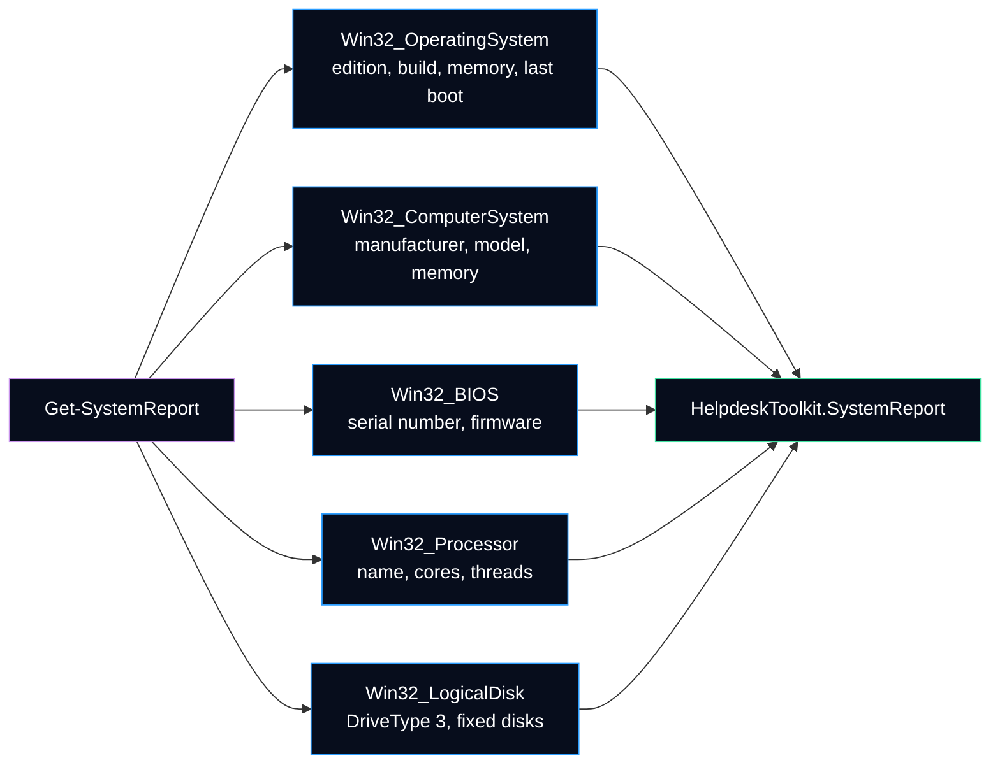

# Get-SystemReport

Collects the system facts asked at the start of a ticket: Windows version, hardware, serial number, memory, disks and uptime. One object per computer, read-only, no administrator rights needed on the local computer.

## Syntax

```powershell
Get-SystemReport [[-ComputerName] <String[]>] [<CommonParameters>]
```

| Parameter | Type | Default | Description |
|---|---|---|---|
| `-ComputerName` | `String[]` | local computer | Computers to query. Accepts pipeline input by value and from a `ComputerName` or `Name` property. Aliases: `CN`, `Name`. `.`, `localhost` and the local name are queried without WinRM. |

The complete help is also available in PowerShell: `Get-Help Get-SystemReport -Full`.

## Where the data comes from



The command uses `Get-CimInstance` and not `Get-WmiObject`: the WMI cmdlets do not exist in PowerShell 7, and CIM uses WinRM for remote computers instead of DCOM.

## Output

Type name: `HelpdeskToolkit.SystemReport`.

| Property | Type | Source and meaning |
|---|---|---|
| `ComputerName` | String | Name reported by the computer itself |
| `Manufacturer`, `Model` | String | `Win32_ComputerSystem` |
| `SerialNumber` | String | `Win32_BIOS.SerialNumber`, trimmed; empty when the firmware has none (common on virtual machines) |
| `BiosVersion` | String | `Win32_BIOS.SMBIOSBIOSVersion` |
| `OperatingSystem` | String | Windows edition, for example `Microsoft Windows 11 Pro` |
| `Version`, `Build` | String | Kernel version and build number, for example `10.0.26100` and `26100` |
| `Architecture` | String | `64-bit` or `32-bit` |
| `InstallDate` | DateTime | Installation date of Windows (a feature update can change it) |
| `Processor` | String | Name of the first processor, extra spaces removed |
| `ProcessorCount` | Int32 | Number of processor sockets |
| `Cores`, `LogicalProcessors` | Int32 | Totals for all processors |
| `Memory` | String | Memory usable by Windows, for example `16 GB` |
| `MemoryBytes` | Int64 | Same value in bytes |
| `MemoryUsedPercent` | Double | Memory in use at the time of the query |
| `Disks` | Object[] | One `HelpdeskToolkit.SystemReport.Disk` per local fixed disk, sorted by letter |
| `LastBootTime` | DateTime | Last full start of Windows |
| `Uptime` | TimeSpan | Time since `LastBootTime`, for sorting and filtering |
| `UptimeText` | String | Same value as text, for example `12d 4h 7m` |
| `CollectedAt` | DateTime | Time of the query, read on the queried computer |

Each disk has `Drive`, `Label`, `FileSystem`, `Size`, `Free`, `FreePercent`, `SizeBytes` and `FreeBytes`. In the list view a disk is displayed as one line: `C: 100 GB free of 465.76 GB (21.5 %)`.

### Default view

The console shows a short selection (`ComputerName`, `Manufacturer`, `Model`, `SerialNumber`, `OperatingSystem`, `Build`, `Processor`, `Memory`, `MemoryUsedPercent`, `Disks`, `UptimeText`), defined in `HelpdeskToolkit.Types.ps1xml`. The object still has every property: use `Get-SystemReport | Select-Object *` to see them all. `Disks` is a nested list, so expand it (`Select-Object -ExpandProperty Disks`) before sending it to `Export-Csv`.

> [!NOTE]
> Sizes use binary units (1 GB = 1024 MB), like File Explorer. A disk sold as "500 GB" (decimal units) is therefore shown as `465.76 GB`. `Memory` is the memory usable by Windows, which can be slightly lower than the installed memory when part of it is reserved by the hardware or the graphics chip.

## Examples

```powershell
# Report of the local computer
Get-SystemReport

# Only the disks
Get-SystemReport | Select-Object -ExpandProperty Disks

# Has the computer restarted in the last 7 days?
Get-SystemReport | Where-Object { $_.Uptime.TotalDays -gt 7 }

# Short inventory of several computers in a CSV file
'PC-EXAMPLE01', 'PC-EXAMPLE02' | Get-SystemReport -ErrorAction Continue |
    Select-Object ComputerName, Model, SerialNumber, OperatingSystem, Build, UptimeText |
    Export-Csv -Path .\inventory.csv -NoTypeInformation
```

## Remote computers

| Requirement | Why |
|---|---|
| WinRM enabled on the remote computer (`Enable-PSRemoting`, often by GPO in a domain) | `Get-CimInstance -ComputerName` uses WS-Management |
| Firewall allows WinRM (TCP 5985 for HTTP) | Default WinRM listener |
| The current user may query the remote computer | No credential is stored or asked by the command |

A computer that cannot be reached produces a non-terminating error that names it (category `ConnectionError`); the other computers are still reported. Add `-ErrorAction Stop` to stop at the first error instead.

## Reading the uptime in a ticket

A long uptime often explains pending updates, slow sessions or a driver that was installed but is not active yet. Before asking the user to "restart", note that with **Fast Startup** (enabled by default) the **Shut down** button hibernates the Windows kernel session instead of closing it, so `LastBootTime` may not change. **Restart** always performs a full boot.

## Tests

[`Tests/Public/Get-SystemReport.Tests.ps1`](../../Tests/Public/Get-SystemReport.Tests.ps1) mocks `Get-CimInstance` with a fictitious computer (`PC-EXAMPLE01`): values, disk order, uptime, local and remote queries, pipeline input and the unreachable computer case. The tests never read the computer they run on.

---

**Reference:** [Get-CimInstance (Microsoft Learn)](https://learn.microsoft.com/en-us/powershell/module/cimcmdlets/get-ciminstance) · [Win32_OperatingSystem class (Microsoft Learn)](https://learn.microsoft.com/en-us/windows/win32/cimwin32prov/win32-operatingsystem) · [Win32_LogicalDisk class (Microsoft Learn)](https://learn.microsoft.com/en-us/windows/win32/cimwin32prov/win32-logicaldisk) · [Fast startup causes hibernation or shutdown to fail (Microsoft Learn)](https://learn.microsoft.com/en-us/troubleshoot/windows-client/setup-upgrade-and-drivers/fast-startup-causes-system-hibernation-shutdown-fail)
