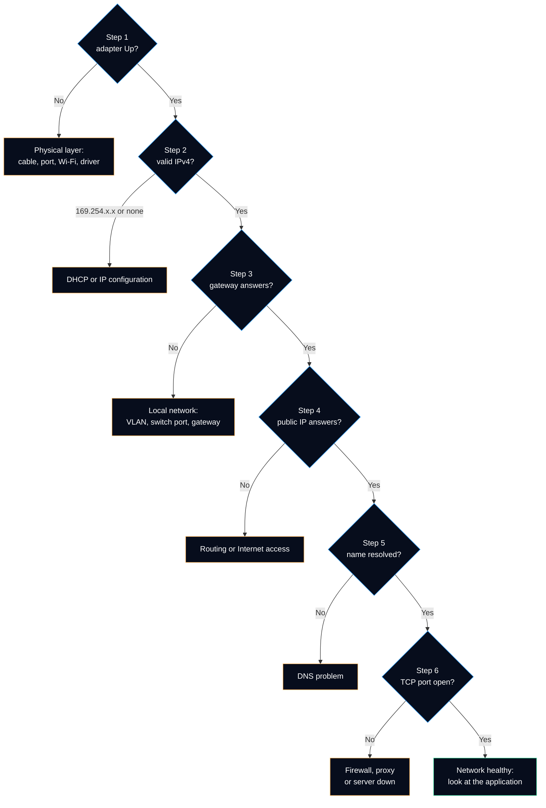

# Test-NetworkHealth

Tests the network of the local computer layer by layer and tells where it stops: link, IP address, gateway, Internet, DNS or service port. One object with the status of each step and a diagnosis to copy in the ticket. Read-only, no administrator rights needed.

It automates the bottom-up method of the [Network Troubleshooting runbook](https://github.com/Bazeeza/Technical-Runbooks/blob/main/04-Network-Troubleshooting/README.md): a layer can only work if the layers below it work, so the first layer that fails is where the fault is.

## Syntax

```powershell
Test-NetworkHealth [-InterfaceAlias <String>] [-PublicAddress <String>] [-DnsName <String>]
    [-TargetHost <String>] [-Port <Int32>] [-TimeoutMilliseconds <Int32>] [<CommonParameters>]
```

| Parameter | Type | Default | Description |
|---|---|---|---|
| `-InterfaceAlias` | `String` | adapter of the best default route | Adapter to test, as shown by `Get-NetAdapter` (`Ethernet`, `Wi-Fi`). Without a default route: the first connected adapter. |
| `-PublicAddress` | `String` | `1.1.1.1` | Public IP address pinged in step 4. Must be an IP address: this step tests routing **without** DNS. |
| `-DnsName` | `String` | `www.microsoft.com` | Name resolved in step 5. |
| `-TargetHost` | `String` | value of `-DnsName` | Host name or IP address of the service tested in step 6. |
| `-Port` | `Int32` | `443` | TCP port tested in step 6 (1 to 65535). |
| `-TimeoutMilliseconds` | `Int32` | `1000` | Maximum wait of each ping and of the TCP connection (100 to 10000). |

The complete help is also available in PowerShell: `Get-Help Test-NetworkHealth -Full`.

## The six steps

| Step | Test | Source | Fails when |
|---|---|---|---|
| 1 Link | The adapter is `Up` | `Get-NetAdapter` | Cable unplugged, Wi-Fi disconnected, adapter disabled or missing |
| 2 IP address | An IPv4 address that is not APIPA | `Get-NetIPAddress` | No address, or only `169.254.x.x`: no DHCP server answered |
| 3 Gateway | The default gateway answers ping | `Get-NetRoute`, ICMP echo | No default route, or no reply from the gateway |
| 4 Internet | A public IP address answers ping | ICMP echo | Router, firewall or Internet provider |
| 5 DNS | The name resolves through the configured DNS servers | `Get-DnsClientServerAddress`, `Resolve-DnsName -DnsOnly` | No DNS server, or no address in the answer |
| 6 Port | A TCP connection opens to the service | TCP connect with a timeout | Firewall, proxy or server down |



### Status of a step

| Status | Meaning |
|---|---|
| `Pass` | The layer works. |
| `Fail` | The layer does not work. The first `Fail` gives `FailedStep` and `Diagnosis`. |
| `Warning` | A ping did not come back, but a higher test proved that traffic goes through: the gateway or a firewall drops ping on purpose. Not counted as a failure. |
| `Skipped` | A lower layer makes the test meaningless: no link, no valid address, or a name that cannot be resolved while DNS fails. |

Unlike the decision flow above, steps 3 to 6 all run once the computer has a valid address. A gateway that ignores ping is common, so stopping at step 3 would hide a working Internet connection. The command runs every test, then turns the failed ping into a `Warning` when step 4 or step 6 succeeded.

## Output

Type name: `HelpdeskToolkit.NetworkHealth`.

| Property | Type | Meaning |
|---|---|---|
| `ComputerName` | String | Local computer name |
| `InterfaceAlias`, `InterfaceDescription` | String | Adapter tested |
| `LinkSpeed` | String | Negotiated speed, for example `1 Gbps`. A gigabit card at `100 Mbps` often means a damaged cable pair. |
| `MacAddress` | String | Physical address of the adapter |
| `IPv4Address`, `PrefixLength` | String, Int32 | Address of the adapter; an APIPA address is shown when it is the only one |
| `AddressSource` | String | `Dhcp`, `Manual` (static) or `WellKnown` (APIPA) |
| `DefaultGateway` | String | Next hop of the default route of the adapter |
| `DnsServers` | String[] | IPv4 DNS servers configured on the adapter |
| `Healthy` | Boolean | `True` when no step failed (warnings allowed) |
| `FailedStep` | String | Name of the first step that failed, empty when healthy |
| `Diagnosis` | String | What the failure means and what to do next |
| `Checks` | Object[] | Six `HelpdeskToolkit.NetworkHealth.Check` objects: `Step`, `Name`, `Status`, `Detail`, `Diagnosis` |
| `CollectedAt` | DateTime | Time of the test |

### Default view

The console shows `InterfaceAlias`, `LinkSpeed`, `IPv4Address`, `DefaultGateway`, `DnsServers`, `Healthy`, `FailedStep`, `Diagnosis` and `Checks`. Every property stays on the object (`Select-Object *`). Example with **fictitious** values (documentation addresses), on a network whose gateway drops ping:

```text
PS> Test-NetworkHealth | Select-Object -ExpandProperty Checks

Step Name       Status  Detail
---- ----       ------  ------
   1 Link       Pass    Ethernet is Up at 1 Gbps.
   2 IP address Pass    192.0.2.25/24 (Dhcp).
   3 Gateway    Warning 192.0.2.1 did not answer ping (TimedOut). Traffic still goes through it: the gateway probably blocks ping.
   4 Internet   Pass    1.1.1.1 answered in 3 ms.
   5 DNS        Pass    www.microsoft.com resolved to 192.0.2.80.
   6 Port       Pass    www.microsoft.com:443 answered in 12 ms.
```

## Examples

```powershell
# Full check of the adapter in use, up to HTTPS on www.microsoft.com
Test-NetworkHealth

# The six steps as a table
Test-NetworkHealth | Select-Object -ExpandProperty Checks

# One line for the ticket when something fails
$health = Test-NetworkHealth
if (-not $health.Healthy) { "$($health.FailedStep): $($health.Diagnosis)" }

# Internal site through the VPN or the internal DNS
Test-NetworkHealth -DnsName 'intranet.corp.example.com' -TargetHost 'intranet.corp.example.com'

# Network printer on its raw printing port
Test-NetworkHealth -TargetHost 'print01.corp.example.com' -Port 9100

# Test the Wi-Fi adapter while the cable is still plugged in
Test-NetworkHealth -InterfaceAlias 'Wi-Fi'
```

Useful ports for `-Port`: `443` HTTPS · `80` HTTP · `445` SMB (file shares) · `3389` RDP · `9100` and `631` printing (raw and IPP) · `5060` SIP over TCP. A TCP test cannot test UDP services such as DNS queries or VoIP audio.

## Design choices

| Choice | Why |
|---|---|
| .NET `Ping` class instead of `Test-Connection` | `Test-Connection` changed its parameters and its output in PowerShell 7. The .NET class gives the same result in 5.1 and 7, with a timeout per reply. |
| TCP connect with a timeout instead of `Test-NetConnection -Port` | `Test-NetConnection` also pings the host and can wait about 20 seconds before it reports a filtered port. The command answers in about one second per test. |
| `Resolve-DnsName -DnsOnly` | Only the DNS protocol is used, not LLMNR or NetBIOS, so a name that resolves "by chance" on the local network does not hide a DNS failure. |
| Ping failures become a `Warning` when traffic passes | Many gateways and firewalls drop ICMP on purpose. The TCP test proves the path. |
| Local computer only | The question is "can **this** computer reach the network?". From another computer, the test would measure the technician's network. On a remote computer, run it through `Invoke-Command` after copying the module. |
| No repair | The command does not renew the lease, flush the DNS cache or reset the stack: those actions come after the diagnosis (see the runbook, section *Quick repair*). |

> [!NOTE]
> The result contains real addresses of the computer (IP, gateway, DNS, MAC). Remove them before pasting the output in a public place, as done in the examples of this page, which only use the documentation ranges `192.0.2.0/24` (RFC 5737) and `00-00-5E-00-53-xx` (RFC 7042).

## Tests

[`Tests/Public/Test-NetworkHealth.Tests.ps1`](../../Tests/Public/Test-NetworkHealth.Tests.ps1) mocks the network commands with a fictitious workstation: healthy network, best default route, named adapter, unplugged or disabled adapter, no adapter, APIPA, no address, gateway or Internet that ignores ping, DNS failure, no DNS server, closed port, and the parameters passed to each test. The private helpers `Test-IcmpEcho` and `Test-TcpPort` are tested on the loopback address only.

---

**Reference:** [Get-NetAdapter](https://learn.microsoft.com/en-us/powershell/module/netadapter/get-netadapter) · [Get-NetIPAddress](https://learn.microsoft.com/en-us/powershell/module/nettcpip/get-netipaddress) · [Get-NetRoute](https://learn.microsoft.com/en-us/powershell/module/nettcpip/get-netroute) · [Resolve-DnsName](https://learn.microsoft.com/en-us/powershell/module/dnsclient/resolve-dnsname) · [Test-NetConnection](https://learn.microsoft.com/en-us/powershell/module/nettcpip/test-netconnection) · [Ping class (.NET)](https://learn.microsoft.com/en-us/dotnet/api/system.net.networkinformation.ping) · [TcpClient class (.NET)](https://learn.microsoft.com/en-us/dotnet/api/system.net.sockets.tcpclient) · [RFC 3927: IPv4 link-local addresses (APIPA)](https://www.rfc-editor.org/rfc/rfc3927) · [RFC 5737: IPv4 documentation addresses](https://www.rfc-editor.org/rfc/rfc5737)
